  
  

# Edmilson Gomes

**Suporte de TI · Cibersegurança · Automação · Desenvolvimento**

Desenvolvo soluções para resolver problemas de TI, organizar operações e apoiar decisões de segurança. Compartilho projetos, estudos e documentação em suporte, SOC / Blue Team, automação e análise de dados.

Apresento cada projeto com o problema que ele resolve, as decisões de implementação, as evidências de validação e os limites atuais.

**[Conheça meu portfólio](https://edy-gomes-portfolio.edy-scanurl-family-worker.workers.dev/)** · [LinkedIn](https://www.linkedin.com/in/edmilsongomes21/) · [Contato](mailto:edmilsongsousa20@gmail.com)

## Projetos selecionados

| Projeto | O que você encontra |
|---|---|
| [EDY HelpDesk](https://github.com/EDY075/EDY-HelpDesk) | Service Desk com tickets, SLA, ativos e diagnósticos somente leitura. |
| [EDY SOC Analytics](https://github.com/EDY075/EDY-SOC-Analytics) | Análise de SOC no Power BI com dados sintéticos, DAX e MITRE ATT&CK. |
| [EDY VERDICT](https://github.com/EDY075/EDY-VERDICT) | Verificação local de repositórios, binários, aplicativos e URLs. |
| [EDY ScanURL Family](https://github.com/EDY075/edy-scanurl-family) | Web, PWA e Android para consultar sinais públicos de lojas e URLs. |
| [WAR ROOM](https://github.com/EDY075/WAR_ROOM) | Experiência documental sobre incidentes cibernéticos, com mapas, capítulos e narração. |
| [EDY RECON](https://github.com/EDY075/EDY-RECON) | Toolkit de OSINT e reconhecimento autorizado, com relatórios TXT / HTML. |
| [EDY SHADOWCAT · case público](https://edy-gomes-portfolio.edy-scanurl-family-worker.workers.dev/work/edy-shadowcat) | Orquestração de reconhecimento autorizado e evidências. Repositório privado. |

[Explore os cases no portfólio](https://edy-gomes-portfolio.edy-scanurl-family-worker.workers.dev/work) · [Veja todos os repositórios públicos](https://github.com/EDY075?tab=repositories)

## Apresentação em vídeo

Uma visita ao portfólio e aos projetos selecionados, em desktop e mobile.

https://github.com/user-attachments/assets/7668f4da-9530-4102-8719-9fa3e71c3e60

## Áreas de atuação

- **Suporte e operações:** diagnóstico de hardware e software, atendimento ao usuário, endpoints Windows e documentação técnica.
- **Cibersegurança:** análise de eventos, investigação defensiva, Threat Intelligence e pesquisa em fontes abertas.
- **Desenvolvimento e automação:** interfaces, APIs e integração de fluxos de trabalho, priorizando execução e armazenamento locais.
- **Dados e análise:** dashboards, Power BI, modelagem de dados e relatórios para apoiar decisões.

## Tecnologias

**Python · TypeScript · JavaScript · Rust · React · FastAPI · Node.js · SQLite · Power BI · DAX · Git · Docker · Windows · Linux**

Como essas tecnologias aparecem nos projetos

- **Interfaces:** React, Vite e Streamlit.
- **Backend e dados locais:** FastAPI, Node.js, Express e SQLite.
- **Pesquisa de segurança:** Nuclei, BBOT, Recon-ng e fluxos OSINT autorizados.
- **Análise de dados:** Power BI, DAX e TMDL.
- **Ambientes e ferramentas:** Windows, Linux, Git e Docker.

## Vamos conversar

Aberto a conexões profissionais, oportunidades e projetos em TI, segurança e automação.

[Enviar e-mail](mailto:edmilsongsousa20@gmail.com) · [Conectar no LinkedIn](https://www.linkedin.com/in/edmilsongomes21/) · [Visitar o portfólio](https://edy-gomes-portfolio.edy-scanurl-family-worker.workers.dev/)
